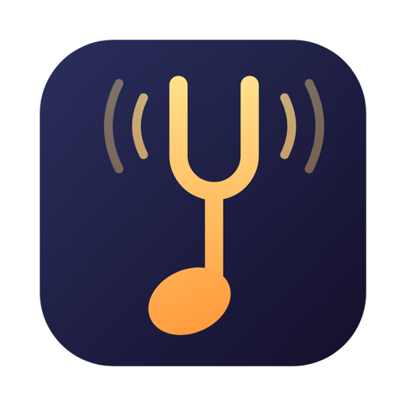

<p align="center">
  
</p>

<h1 align="center">PitchTap</h1>

<p align="center">
  <b>Change the key of any song on your Mac. Same tempo.</b><br>
  Live, for Spotify, Apple Music, YouTube, a video call, or your whole Mac.
</p>

---

## ✨ What it does

PitchTap sits quietly in your menu bar. Turn it on, pick what you want to hear, and slide the pitch up or down. The music stays at the same tempo; only the key changes.

- 🎤 **Sing along in your range.** Drop a song two semitones so the chorus fits your voice.
- 🎸 **Play along with recordings.** Match a song to your instrument's tuning, or transpose to a key you know.
- 🎧 **Just for fun.** Hear a song an octave lower, or retune to A = 432 Hz.

> **What's a semitone?** It's one key on a piano. **+1** moves everything up one key, **+12** a whole octave. **Cents** are for fine tuning: 100 cents make one semitone.

---

## 🚀 Get started on your Mac

**You need:** macOS 14.4 (Sonoma) or newer, and Apple's free command-line developer tools. If you've never installed them, run `xcode-select --install` in Terminal first.

1. **Build the app.** Open Terminal in the `pitchtap` folder and run:
   ```sh
   cd mac && ./build-app.sh
   ```
   This creates **`PitchTap.app`** in the `mac` folder.

2. **Move it to Applications** (optional, but tidy). Drag `PitchTap.app` into your Applications folder, then double-click it.

3. **Find it in your menu bar.** PitchTap has no window or Dock icon. It lives at the top-right of your screen:

   <p>
     <picture>
       <source media="(prefers-color-scheme: dark)" srcset="docs/menubar-dark.png">
       
     </picture>
   </p>

   | Icon | Meaning |
   |---|---|
   | Note and fork | PitchTap is **off**; audio plays normally |
   | With little sound waves | PitchTap is **on** and shifting |
   | `+3`, `−2`, `+0.25`… | How far the pitch is shifted, in semitones |

4. **Allow audio access once.** The first time you switch PitchTap on, macOS asks whether PitchTap may record system audio. Click **Allow**. PitchTap needs this to hear the audio before changing it. Nothing is saved or sent anywhere.

> 💡 **Start at login:** System Settings › General › **Login Items** › **+** › choose PitchTap.

---

## 🎚️ Using PitchTap

Click the menu-bar icon to open the controls:

| Control | What it does |
|---|---|
| **Pitch shift** switch | Turns PitchTap on or off. Off means everything sounds normal again, instantly. |
| **Source** | What to shift: **All system audio**, or a single app. The list fills in by itself with every app currently using sound, and **♪** marks the ones playing right now. |
| **Semitones** | −12 to +12. Each step is one piano key. |
| **Fine tune** | −50 to +50 cents, for in-between tunings. |
| **Reset** | Back to normal pitch (0). |

### ⌨️ Shortcuts (work from any app)

| Keys | Action |
|---|---|
| <kbd>⌃ Control</kbd> <kbd>⌥ Option</kbd> <kbd>↑</kbd> | Up one semitone (also turns PitchTap on) |
| <kbd>⌃ Control</kbd> <kbd>⌥ Option</kbd> <kbd>↓</kbd> | Down one semitone |
| <kbd>⌃ Control</kbd> <kbd>⌥ Option</kbd> <kbd>0</kbd> | Reset to normal pitch |

### 🎯 Handy settings

| I want to… | Semitones | Fine tune |
|---|---|---|
| Make a song easier to sing (lower) | −1 to −3 | 0 |
| Hear it an octave down / up | −12 / +12 | 0 |
| Retune to A = 432 Hz | 0 | −32 |
| Match a guitar tuned half a step down | −1 | 0 |

### 🧭 Choosing a source

- **One app** (e.g. *Spotify*) shifts only that app. Everything else, like notifications or a video call, sounds normal. PitchTap remembers your choice: if the app is closed, it waits and starts shifting the moment the app plays again.
- **All system audio** shifts everything your Mac plays, including alert sounds.
- Browsers show up as one entry (e.g. *Google Chrome*) even though they use several background processes for sound.

### 💬 What the status line means

| Message | What's going on |
|---|---|
| *Off — audio plays normally* | PitchTap isn't touching anything. |
| *Shifting Spotify → MacBook Pro Speakers* | All good: that source is being shifted and played on that device. |
| *Waiting for Spotify to play audio…* | The chosen app is closed or hasn't made a sound yet. Press play. |
| *Nothing playing from …* | PitchTap is ready, but no sound is coming in. See troubleshooting below. |

---

## 🌐 Chrome extension (for any browser tab)

Prefer to shift just one browser tab, or not on a Mac? PitchTap also comes as a Chrome extension.

1. Open `chrome://extensions` and switch on **Developer mode** (top-right).
2. Click **Load unpacked** and choose the `extension` folder.
3. Pin **PitchTap** from the puzzle-piece menu so its icon is always visible.
4. Go to any tab that's playing audio, click the PitchTap icon, and switch **Pitch shift** on.

Good to know:
- It works on **one tab at a time**. On a different tab, the popup offers **Shift this tab instead**.
- Chrome only allows this right after you click the icon. After restarting Chrome, click the icon once on your tab to resume.
- Chrome blocks its own pages (`chrome://…`) and the Web Store.
- There's a small delay (about 0.1 s), which is unnoticeable for music and slightly noticeable on videos.

---

## 🛠️ Troubleshooting

<details>
<summary><b>I switched it on but hear nothing</b></summary>

Open System Settings › Privacy & Security › **Screen & System Audio Recording**, make sure **PitchTap** is switched on, then switch PitchTap off and on again from its menu.
</details>

<details>
<summary><b>My app isn't in the Source list</b></summary>

Apps appear once they start using sound. Press play in the app, then reopen the menu.
</details>

<details>
<summary><b>I switched from speakers to headphones</b></summary>

Nothing to do. PitchTap follows your current output device automatically.
</details>

<details>
<summary><b>How do I get normal sound back?</b></summary>

Flip the **Pitch shift** switch off, press <kbd>⌃</kbd><kbd>⌥</kbd><kbd>0</kbd> for zero shift, or quit PitchTap. If PitchTap ever crashes, macOS restores the original audio automatically.
</details>

<details>
<summary><b>Does it work with Spotify's encrypted music?</b></summary>

Yes. PitchTap never touches the music files. It only adjusts the sound after the app has already played it, the same sound your speakers would get.
</details>

---

## 🔍 How it works

```
 Your app ──sound──▶ PitchTap ──shifted sound──▶ speakers / headphones
   (its direct sound is muted while PitchTap is on)
```

1. **Listen in.** macOS lets PitchTap take a copy of one app's audio (or all audio). The original is muted, so you don't hear it twice.
2. **Shift.** The audio is cut into tiny overlapping slices, each slice is moved up or down in pitch, and they're blended back together. The notes change; the tempo doesn't.
3. **Play.** The result goes straight to your speakers, a few hundredths of a second behind the original.

---

## 👩‍💻 For developers

```
pitchtap/
├── mac/         PitchTap menu-bar app (Swift, SwiftPM; no Xcode project needed)
├── extension/   Chrome MV3 extension
├── design/      Logo sources and the icon build script
└── docs/        Images used in this README
```

| Task | Command |
|---|---|
| Build the app | `mac/build-app.sh` |
| Offline DSP self-test | `mac/PitchTap.app/Contents/MacOS/PitchTap --selftest` |
| Live capture probe | `open -W mac/PitchTap.app --args --probe 8 /tmp/probe.txt system` (or a bundle ID such as `com.spotify.client`) |
| Regenerate icons from the logo | `design/build-icons.sh`, then `mac/build-app.sh` |

**Under the hood**
- **Mac app:** a Core Audio process tap captures the source (macOS 14.4+), and an AVAudioUnitTimePitch effect shifts it.
- **Chrome extension:** `tabCapture` captures the tab, and [Signalsmith Stretch](https://signalsmith-audio.co.uk/code/stretch/) (MIT, WASM) shifts it.
- **Menu-bar icon:** drawn in code, in `mac/Sources/PitchTap/MenuBarIcon.swift`.
